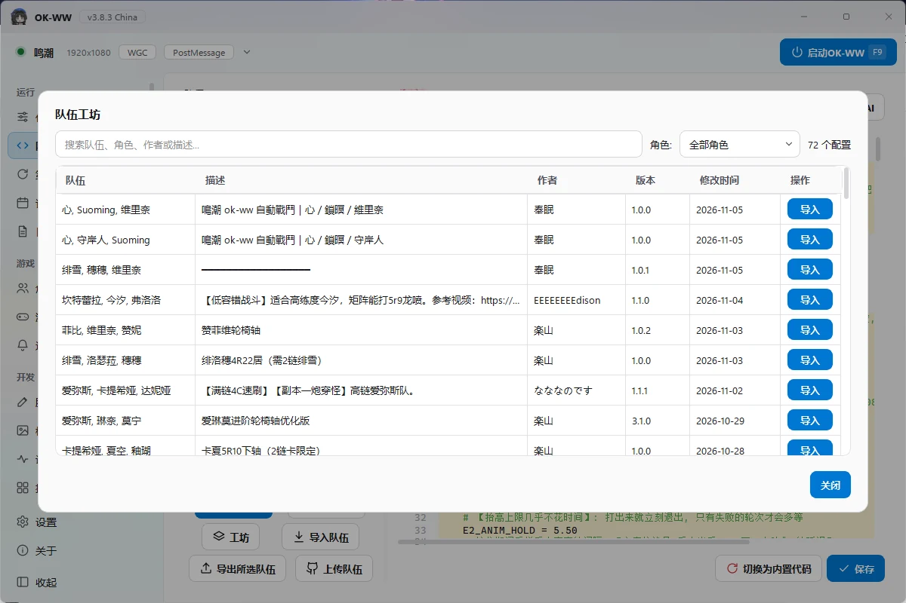
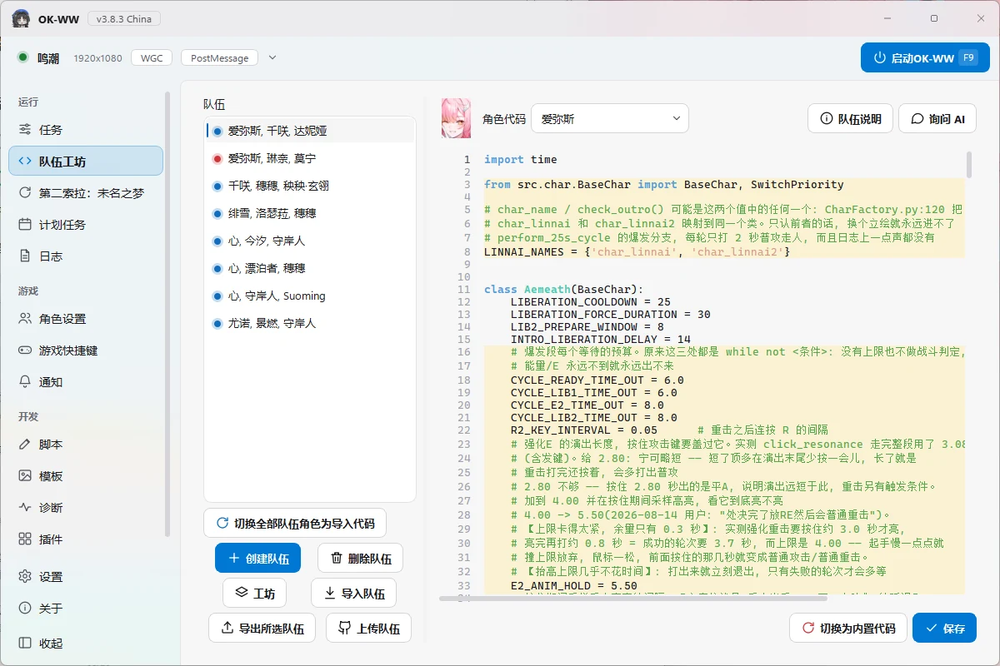

# OK-WW 队伍工坊插件

旧版 OK-WW 的「角色代码 / 队伍创意工坊」恢复成独立插件：
浏览社区配队、一键导入、编辑角色代码、导出分享，并在内置代码与导入代码之间切换。

## 功能

- **工坊浏览**：按队伍、角色、作者、描述搜索，查看版本与详情。
- **一键导入**：下载配队 ZIP，预览确认后导入并自动重载。
- **队伍管理**：新建、删除、导入本地 ZIP、导出配队。
- **代码编辑**：按角色修改自动化代码，保存为导入代码，或重置回内置代码。
- **内置 / 导入切换**：单个队伍切换，也可一键切换全部队伍。
- **Ask AI**：把当前代码和提示词复制到剪贴板，方便交给 AI 修改。
- **上传队伍**：打开镜像仓库（原仓库已下线，不再接收新配队）。
- **插件内更新**：左侧「更新插件」直接检查 GitHub Release、下载并暂存，重启 OK-WW 生效。

典型用途：直接用社区配队、升级后找回旧版入口、自己改角色代码、分享配队、多套配队来回切换。

## 安装

> **OK-WW v3.8.4 起「插件」页默认隐藏**
>
> v3.8.4（2026-11-17）把 `working/config.py` 里的 `'plugin'` 设为 `False`，左侧不再创建 Plugins 页。已安装的插件仍会加载，只是没有图形入口安装/更新。
>
> - **v3.8.3 及更早**：用下面的「从 GitHub / 从 ZIP」通过 Plugins 页安装。
> - **v3.8.4 及更新**：关闭 OK-WW，把 zip 解压到
>   `OK-WW 安装目录\data\apps\ok-ww\working\ok_import\ok_team_workshop\`
>   （先备份旧目录，`manifest.json` 要在目录根下），再启动 OK-WW。
>   也可以先把 `working\config.py` 的 `'plugin': False` 改成 `True` 恢复 Plugins 页，再按下面方式安装；OK-WW 每次更新都会重置这个文件。
>
> **v3.8.4+ 兼容性（1.1.2 起自动处理）**：v3.8.4 移除了 `src/char/CustomCharLoader.py`、`CharFactory.apply_team_char_classes`，以及 `BaseCombatTask.load_chars()` 里应用导入代码的那一行。1.1.2 起插件内置 `TeamCodeCompat.py` 和 `vendor/CustomCharLoader.py`：宿主缺哪一部分就补哪一部分，并在读完队伍后应用导入代码，**不需要再恢复 `working\src\char\` 下的文件，也不用为了兼容退回 v3.8.3**。升级 OK-WW 后兼容层自动跟随，日志里会打印 `ok-workshop compatibility: {...}`。

**从 GitHub（推荐，需 Plugins 页）**

1. OK-WW → **Plugins** → **Add from GitHub**，填入：
   `https://github.com/Ryshcyn/ok-team-workshop`
2. 选择 Release 里的 `ok-team-workshop-1.1.2.zip` 安装。
3. 首次安装一般会直接出现左侧「队伍工坊」；如果没有出现，重启一次 OK-WW。覆盖已有安装时，按卡片提示重启生效。

之后插件页会自动检查更新；1.1.2 起也可以直接在队伍工坊左侧点「更新插件」，不依赖 Plugins 页。

**从 ZIP（需 Plugins 页）**

到 [Releases](https://github.com/Ryshcyn/ok-team-workshop/releases) 下载 zip → **Add from ZIP**。首次安装直接生效；覆盖安装按提示重启。本地 ZIP 安装不会记录 GitHub 来源，不会自动检查更新。

**手动安装（v3.8.4 及更新，无需 Plugins 页）**

1. 到 **Releases** 下载 `ok-team-workshop-<版本>.zip`。
2. 完全退出 OK-WW。
3. 备份 `...\working\ok_import\ok_team_workshop`；首次安装则新建该目录。
4. 把 zip 解压到该目录，确认 `manifest.json` 和 `WorkshopTab.py` 在同一层。
5. 启动 OK-WW，左侧应出现「队伍工坊」。

不需要额外安装依赖。

## 更新与删除

- **v3.8.4 及更新（默认无 Plugins 页）**：1.1.2 起在队伍工坊左侧点「更新插件」即可——插件会检查 GitHub Release、下载并合并兼容层后交给主程序暂存，重启 OK-WW 生效。也可以继续用手动方式：到 Releases 下载新 zip，退出 OK-WW，解压覆盖 `working\ok_import\ok_team_workshop`，再启动。
- **有 Plugins 页**：点 **Update to vX.Y.Z**，这是暂存更新，按提示重启 OK-WW 后才替换；重启前可点 **Cancel pending change** 取消。
- **删除**：退出 OK-WW 后直接删除 `working\ok_import\ok_team_workshop`；有 Plugins 页时删除也需要重启生效。
- 更新/重装不会清除已导入的队伍和角色代码（保存在 `working\configs\custom_teams` 等主程序配置里）。

## 使用

**从工坊导入**：点左侧「工坊」→ 搜索或按角色筛选 → 双击查看详情 → 「导入」→ 确认。导入会覆盖该队伍当前的本地代码，预览里会提示。

**编辑代码**：左侧选队伍，右侧选角色，修改后点「保存」写入导入代码；改坏了点「重置为内置代码」恢复。编辑器会高亮与内置代码不同的行。

**导出 / 上传**：选中队伍 →「导出选中」，填写名称、描述、作者、版本生成 ZIP；「上传队伍」打开镜像仓库。

**切换代码**：「切换为导入代码 / 切换为内置代码」按队伍切换；「切换全部队伍」整体切换，从未导入过代码的队伍会被跳过。

## 数据源与网络

原官方配队仓库 `ok-oldking/ok-ww-char-code` 及其 CDN 已于 2026 年 11 月下线（返回 404）。插件改为读取社区抢救镜像：

1. [yamadafz/ok-ww-char-code](https://github.com/yamadafz/ok-ww-char-code)（主源，2026-11-08 快照，约 50 个队伍 / 72 份代码）
2. [derek3411888/ok-ww-char-code](https://github.com/derek3411888/ok-ww-char-code)（备用源）

镜像只是原仓库的静态快照，**不会再收录新配队**。索引走 `raw.githubusercontent.com`，需要本机能访问该域名；索引超时 15 秒，ZIP 超时 30 秒。所有源都不可用时会明确报错，而不是显示空列表。

## 兼容与安全

- 依赖主程序的 `src.char.CustomCharLoader`、`src.char.CharFactory`、`src.task.BaseCombatTask` 和 `ok.ui.qt` 接口。1.1.2 起缺失的部分由插件内 `TeamCodeCompat.py` 自动补齐（含自带的 `vendor/CustomCharLoader.py`），OK-WW 移除该功能后仍可用；上游若大改这些接口的结构，日志里会有 `ok-workshop compatibility` / `imported code ... not applied` 提示。
- 配队本质是 Python 代码，导入前请阅读预览，只导入信任的来源；导入前建议先导出备份。
- OK-WW 作者已停止维护并下线工坊，使用第三方配队存在账号风险，请自行判断。
- 插件只是给 OK-WW 增加一个页面，不修改主程序、不读取游戏内存；导入代码的实际战斗效果需自行验证。

## 来源与许可证

`WorkshopTab.py` 衍生自 `ok-oldking/ok-wuthering-waves` 的 `src/gui/CharacterCodeTab.py`，修改说明见 [NOTICE.md](NOTICE.md)。原项目采用 **AGPL-3.0**，本仓库保留完整许可证文本：[LICENSE.txt](LICENSE.txt)。社区配队内容由各自作者维护，不包含在本仓库中。

`vendor/CustomCharLoader.py` 取自同一项目提交 `21829df6` 的 `src/char/CustomCharLoader.py`，作为宿主删除该模块后的兜底，许可证同为 **AGPL-3.0**。
